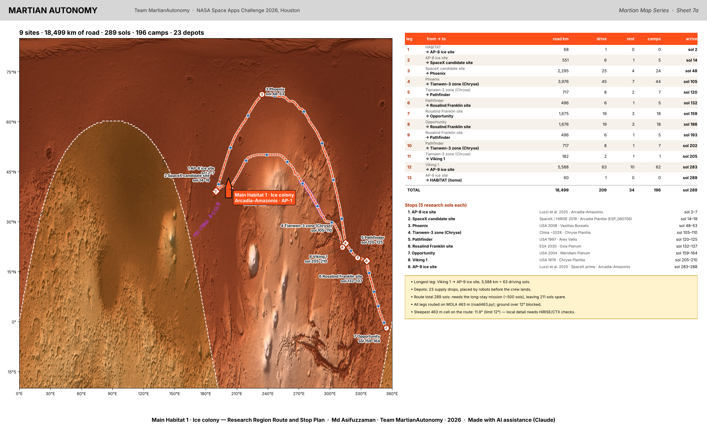

# Martian Autonomy — Two Habitats, Every Landing Site by Road

**Team MartianAutonomy** · Md Asifuzzaman · NASA Space Apps Challenge 2026 (Houston, TX)
**Challenge:** Interplanetary Survival Guide: Martian Map

**Live app:** https://asif-ucchwas.github.io/martian_autonomy/ · **Demo (7 slides):** [demo/MartianAutonomy_demo.pdf](demo/MartianAutonomy_demo.pdf)

An interactive survival map that plans how a 2-person crew could live on Mars and reach every landing site and planned landing site by road, routed on NASA terrain data.

## The plan in numbers

| | Habitat 1 · Ice colony | Habitat 2 · Sun colony |
|---|---|---|
| Where | AP-1, Arcadia–Amazonis, 39.81°N 202.08°E — ice < 1 m deep (Luzzi et al. 2025) | Elysium Planitia, 4.49°N 135.61°E — 1.2 km from InSight |
| Sites | 9 | 7 + InSight |
| Route | set route; Opportunity branch out and back | shortest closed loop (Held-Karp) |
| Road | 18,499 km | 18,772 km |
| Sols (drive + rest + research) | 289 | 282 |
| Camps / supply depots | 196 / 23 | 205 / 23 |
| Steepest 463 m road cell | 11.9° | 12.0° |
| Radiation on the route | ~190 mSv | ~185 mSv |

- Link road between the habitats: 4,252 km.
- Loose dust (TES thermal inertia < 100): 3,390 of 41,523 km of road (8 %). Scenario at half speed on dust: H1 307, H2 296 sols.
- Both routes fit the 372-sol calm half of the Mars year (start at the northern spring equinox) and a 500-sol stay.
- **The hard parts are not the roads:** the 180-day cruise each way already exceeds NASA's 600 mSv career limit, and robots that pre-place the depots would need to average ~16 km per sol — about 39× Perseverance's best single sol.

## How it works

1. **Habitats on checked ground** — pads and habitat spots picked on CTX (22 m) and HiRISE (1 m) terrain models: pad slope ≤ 15°, habitat 1–2 km from the pad, suited-walking zones mapped.
2. **Regions** — every landing site and planned site belongs to its nearest habitat.
3. **Roads, pass 1** — A* on the MGS MOLA global DEM at 5.2 km cells, slopes > 5° blocked (`scripts/routing/global_roads.py`).
4. **Roads, pass 2** — every leg re-routed on the full 463 m MOLA DEM in a ±40 km strip, ground over 12° blocked, loose dust costs double time; sparse-graph Dijkstra, 16 directions (`road463.py`).
5. **Dust** — TES night thermal inertia sampled every 2 km on every road (`ti_roads.py`).
6. **Sol-by-sol plan** — slope-dependent speed (12 km/h on the flat), 8 driving h per sol, a rest sol after 6 driving sols, 5 research sols per site, a camp each night, a depot every 800 km placed by robots before the crew lands (`regions_plan.py`, `build_data.py`).
7. **Web app** — one static Leaflet page (`index.html`): routes, live mission panel, CTX photos and 24 NASA Trek HiRISE/CTX site close-ups when zoomed in, dust and slope layers, 30-sol stay switch, climate, radiation, robots and a mission calendar. Works on phones (bottom-sheet panel).

Full write-up with every number and source: [docs/MARTIAN_MAP.md](docs/MARTIAN_MAP.md). Rover, astronaut and habitat limits: [docs/assumed_values.md](docs/assumed_values.md). Printable maps: [maps/](maps/).

## Repository

| Folder | What |
|---|---|
| `index.html`, `basemap.jpg`, `ti_overlay.png`, `zoom/` | The web app (served by GitHub Pages) |
| `scripts/routing/` | `global_roads.py` (pass 1), `road463.py` (pass 2), `ti_roads.py` (dust), `run_h1_v5.sh` + `integrate.py` (Habitat 1 v5 route), `trek_probe.py` (checks NASA Trek layers) |
| `scripts/plan/` | `regions_plan.py` (regions, visit order, sols), `sites.py` (landing sites) |
| `scripts/app/` | `build_data.py` (timeline, camps, depots, robots, calendar), `build_site.py` + `index.template.html` (the app) |
| `scripts/maps/` | `regions_map.py` (printable PDF maps) |
| `scripts/prep/` | `astronaut_walk.py`, `rover_speed.py`, `make_tiles.py` (validation and prep) |
| `data/` | Routed roads (`legs_463.geojson`), measured legs, plans, dust per leg, app data |
| `maps/` | Route maps (PDF, PNG) |
| `demo/` | 7-slide demo |

Scripts were run on a local machine and use absolute paths from that machine; the 2 GB MOLA 463 m DEM and the terrain models are not in this repo (see the data list for download links).

## NASA and other data

- **MGS MOLA global DEM 463 m** (NASA/USGS) — every road, slope and travel time; base map.
- **MGS TES thermal inertia, night 2007** (NASA PDS, Putzig & Mellon 2007) — loose-dust check.
- **MRO HiRISE DTMs** DTEEC_037262_1845, DTEEC_010573_1755, DTEEC_018854_1755, DTEEC_060706_2195 and **MRO CTX DTM** J20_052424/J20_052490 (NASA/JPL/UArizona/MSSS/USGS) — habitat and pad siting.
- **CTX global mosaic** (Caltech Murray Lab; NASA/JPL/MSSS; served by Esri OnMars) and **NASA Mars Trek** HiRISE / controlled-CTX site mosaics and Viking MDIM 2.1 — imagery in the app.
- **MSL RAD** (Hassler et al. 2014; Zeitlin et al. 2013) — radiation; **InSight** and **Viking Lander 2** weather — climate card.
- NASA DRA 5.0 (NASA/SP-2009-566), NASA-STD-3001; Luzzi et al. 2025 (JGR Planets) for the AP ice sites; ESA, CNSA and Roscosmos landing sites.

Full list with links: [docs/MARTIAN_MAP.md §4](docs/MARTIAN_MAP.md).

## Limits

Craters under ~1.5 km and boulders need HiRISE checks on final approaches. Each routed road ends 0.3–3 km from its site; that last stretch is dashed in the app and not slope-checked. Rover speed on dust is assumed. The mission calendar is a scenario, not a NASA schedule. Depot mass and robot power are not modelled.

## Use of AI

Built with AI assistance (Claude, Anthropic): most code and the web app were written by Claude to the team's specifications; research summaries and text were drafted with Claude and checked against sources and script output. The mission concept, habitat choices, route decisions and all accept-or-redo calls are the team's. All map imagery is NASA/USGS data; no AI-generated images and no NASA branding are used.

## License

Code: MIT (see `LICENSE`). Data and imagery belong to their providers (NASA, USGS, ESA, Caltech, Esri) under their own terms.

## Math and physics

Every formula behind the map, with worked examples: [docs/MATH_AND_PHYSICS.md](docs/MATH_AND_PHYSICS.md)
